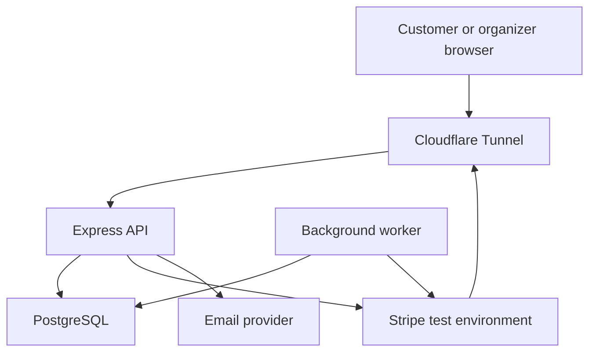

# TicketFlow Architecture

Status: Reviewed draft — implementation gates below remain open  
Updated: 2026-11-04  
Target: Portfolio MVP  
Repository location: `docs/architecture.md`

## 1. Goals and scope

Build a deployed event-ticketing MVP that demonstrates correct reservations under concurrency, reliable payment processing, and understandable module boundaries.

The MVP journey is: sign in → browse a published event → reserve 1–5 tickets of one type → complete Stripe test payment → view issued admission tickets.

The MVP includes one provisioned organizer, email/password authentication, event publication, USD prices, reservation expiry, payment recovery, and private ticket access. Organizer applications, regional currency display, ordinary customer cancellations/refunds, organizer payouts, QR check-in, and microservices are deferred. Recovery refunds for late or duplicate successful payments remain necessary.

This document follows the smaller MVP scope agreed after the broader requirements draft. Before implementation, update `requirements.md` to distinguish this release from the later roadmap. No feature or benchmark is claimed implemented by this architecture.

## 2. Architecture decision

Use a modular monolith: one Express application codebase, one PostgreSQL database, and explicit internal module interfaces. Background processing uses the same codebase and database; it may run as a separate process from the same image.

Compared with microservices, this keeps critical transactions local and reduces deployment and communication complexity. The trade-off is shared deployment and database capacity. Consider extraction only when measurements demonstrate a need for independent scaling, fault isolation, or delivery—not simply after completing the MVP.

### Runtime context



The frontend framework and email provider remain unselected. Email delivery hooks must use an asynchronous, recoverable delivery mechanism before verification and recovery email flows are considered reliable.

## 3. Module ownership

| Module    | Owned tables                                              | Responsibilities                                                            |
| --------- | --------------------------------------------------------- | --------------------------------------------------------------------------- |
| Identity  | users, accounts, sessions, verifications                  | Better Auth integration, authenticated identity, organizer permission       |
| Events    | events, ticket_types                                      | Event ownership, publication, details, price and sales-window configuration |
| Bookings  | bookings, booking_requests, ticket_inventory              | Reservation state, inventory allocation, expiry, confirmation               |
| Payments  | payment_attempts, payment_webhook_events, payment_refunds | Stripe operations, verified payment facts, webhook inbox, recovery refunds  |
| Admission | admission_tickets                                         | Idempotent ticket issuance and ownership-protected ticket access            |

A module owns its mutations and exposes application interfaces. Other modules must not import its infrastructure repositories or directly update its tables. Foreign keys across module-owned tables are allowed in this shared database.

Inventory belongs to Bookings even though organizers configure it through event-management screens. A composition use case coordinates Events and Bookings to create a ticket type and inventory row atomically. Inventory adjustments use Bookings operations.

Health, configuration, logging, database connection management, and transaction infrastructure belong to `platform`, not a business module. Administration is not a separate MVP module.

## 4. Code structure and dependency direction

```text
apps/api/src/
  modules/
    identity/
      application/
      infrastructure/
      http/
      identity.module.ts
    events/
      domain/
      application/
      infrastructure/
      http/
      events.module.ts
    bookings/
      domain/
      application/
      infrastructure/
      http/
      bookings.module.ts
    payments/
      domain/
      application/
      infrastructure/
      http/
      payments.module.ts
    admission/
      domain/
      application/
      infrastructure/
      http/
      admission.module.ts
  workflows/
    confirm-payment.ts
    configure-ticket-type.ts
  platform/
    config/
    database/
    health/
    observability/
  app.ts
  server.ts
  worker.ts
```

Create folders only when there is code to put in them. Identity can delegate authentication to Better Auth without recreating its internals in artificial domain classes.

| Layer          | Responsibility                                          | Dependency rule                                               |
| -------------- | ------------------------------------------------------- | ------------------------------------------------------------- |
| Domain         | Business types, invariants, transition rules            | Plain TypeScript; no Express, Drizzle, Stripe, or Better Auth |
| Application    | Use cases and consumer-specific ports                   | Domain and application contracts                              |
| Infrastructure | Drizzle persistence and provider integrations           | Implements application ports                                  |
| HTTP           | Authentication adaptation, validation, response mapping | Calls application use cases                                   |
| Composition    | Constructs dependencies and coordinates workflows       | Connects modules; does not bypass their ownership             |

`*.module.ts` exposes narrow application capabilities. `app.ts` and workflow composition wire concrete implementations with plain dependency injection. HTTP requests and Drizzle row types do not become domain types.

### Applying SOLID

- Single responsibility: routes translate HTTP, use cases coordinate behavior, repositories persist state.
- Open/closed: introduce extension points for actual variation, such as a payment gateway adapter.
- Liskov substitution: alternative implementations must preserve documented behavior, including transaction and error semantics.
- Interface segregation: define small ports such as reservation eligibility or ticket issuance, rather than a universal service interface.
- Dependency inversion: business use cases depend on ports; composition supplies Drizzle and provider implementations.

Avoid generic base repositories, interfaces for every class, and wrappers that only rename library calls. Repository methods should express required atomic operations rather than encourage unsafe read-then-write sequences.

## 5. Authentication and authorization

Use Better Auth with its Drizzle adapter and database-backed sessions. Generate its schema from the selected configuration, inspect it, and apply reviewed Drizzle migrations. The hand-written auth DBML is provisional until compared with that output.

Configure UUID IDs consistently across authentication and business references. Explicitly map chosen table/column names. Keep `isOrganizer` server-controlled (`input: false`); ordinary registration cannot grant it.

Better Auth handles credentials, sessions, verification, and password recovery mechanisms. TicketFlow enforces booking eligibility and resource ownership. A valid session does not authorize editing another organizer's event or viewing another customer's booking.

Require verified email before reservation. Use secure session cookies, explicit trusted origins, appropriate rate limits, and secret-free error responses. Mount authentication and Stripe webhook handlers according to the installed library requirements; webhook signature verification needs the original request bytes before general JSON parsing.

## 6. Persistence and invariants

Use PostgreSQL with Drizzle for schemas, queries, and versioned migrations. PostgreSQL is the authority for inventory and booking state. No Redis or message broker is required initially.

Essential database protections:

- Nonnegative inventory counters and reserved + sold <= total.
- Booking quantity between 1 and 5, positive USD prices, and matching total.
- Composite ticket/event foreign key to prevent mismatched bookings.
- Partial unique index on customer/event for PENDING bookings.
- Unique customer/idempotency key, Stripe event ID, PaymentIntent ID, refund-per-payment, and booking/ticket number.
- Valid date ordering and required fields.

DBML notes are not executable constraints. Cross-row rules, ownership, price snapshots, and allowed transitions also require transaction-aware application operations. An expired PENDING row must be transitioned before allowing a replacement reservation; the deadline alone does not remove it from the partial index.

`updated_at` is explicitly maintained. Add optimistic version checks where concurrent organizer edits could silently overwrite each other. Do not hard-delete business history.

## 7. Critical transactions

Use a transaction runner that provides application-scoped transactional capabilities; infrastructure binds them to one Drizzle transaction. Domain code never receives the raw database client. A workflow may call several modules within the same transaction.

### Reservation

1. Validate identity, input, and idempotency key.
2. Start a transaction and serialize competing requests for that customer/event, using a stable customer/event guard or an equivalent reviewed strategy.
3. Coordinate reads/locks on current event, ticket type, and inventory so publication, price, and sales eligibility remain valid through commit.
4. Resolve an expired existing pending reservation when necessary; enforce the one-pending rule.
5. Atomically reserve available quantity and create the booking, immutable price snapshot, and successful idempotency record.
6. Commit, then return the booking and expiry.

Same key/payload returns the original booking; a different payload conflicts. The idempotency design currently records successful reservations only. Define retention and expired-key reuse behavior before release.

### Payment initialization

Persist a payment attempt and stable provider idempotency key, commit, then call Stripe. Persist the returned provider ID. If the process crashes after Stripe succeeds but before the ID is saved, retry with the same provider key and reconcile the result. Never hold database locks while making provider requests. Reuse/reconcile an active attempt rather than creating another charge on each client retry.

### Webhook processing and confirmation

Verify the signature, durably insert the event once, then acknowledge receipt. Process asynchronously; do not acknowledge durable acceptance if insertion failed.

Within one transaction, validate the associated payment facts, lock the booking, and choose the outcome:

| Current state                | Outcome                                                |
| ---------------------------- | ------------------------------------------------------ |
| Pending and before deadline  | Confirm, move reserved quantity to sold, issue tickets |
| Pending after deadline       | Expire, release hold, request recovery refund          |
| Expired/cancelled            | Preserve booking state; request recovery refund        |
| Confirmed by same payment    | No duplicate effects                                   |
| Confirmed by another payment | Preserve tickets; refund extra successful payment      |

Persist the accepted confirming payment association unambiguously. The current DBML needs either a `booking_confirmations` record or a carefully constrained confirming-payment reference; select and add that detail before payment implementation. Do not infer the winner from the existence of multiple successful attempts.

Booking confirmation, inventory transfer, ticket issuance, payment association, refund intent when needed, and inbox completion commit together. Duplicate or reordered provider events must not regress terminal outcomes.

### Expiry

Expiry and payment compete for the same booking state. Eligibility ends at the deadline even if cleanup is delayed. Expiry atomically marks the booking expired and releases reserved quantity once.

Use authoritative time sampled after acquiring the relevant locks for the eligibility decision. Do not rely on a request timestamp sampled before waiting for locks.

### Lock discipline

Before implementing each competing workflow, write down one consistent lock hierarchy covering customer/event guards, event rows, ticket types, bookings, and inventory. In particular, reservation cleanup must not acquire booking/inventory locks in the reverse order to payment or expiry. Sort multiple same-kind IDs consistently. Verify this with real database tests; retry deadlocks/serialization failures only with bounded, idempotent whole-transaction retries.

## 8. Checkout deadline decision

The product target is a ten-minute reservation. Select and verify the concrete Stripe checkout flow before coding it; do not assume hosted checkout expiration can match that target.

The current policy accepts confirmation only while a reservation is eligible. A success processed after release is refunded and never resurrects the booking. Delayed notifications can therefore cause a refund even when the customer paid earlier. Explain this policy in checkout and test it. Changing the policy requires an explicit revised inventory/payment design.

## 9. Background work and recovery

A worker polls durable PostgreSQL work for expiry, webhook processing, and recovery refunds. Start with one worker, while using atomic claims and expiring leases so retries or future replicas cannot blindly process the same item concurrently.

- Claim a bounded batch and record ownership/lease expiry.
- Reclaim abandoned work after a lease expires.
- Use a claim token or equivalent ownership check so an old worker cannot overwrite a newer claim.
- Use bounded retries with backoff; permanent/exhausted failures become visible for review.
- Preserve business idempotency even if duplicate processing occurs.
- Reconcile ambiguous Stripe results with stable provider keys and provider state; a local timeout is not proof of failure.

Notification delivery needs durable work as well. Add an email delivery/outbox design before relying on reliable verification, password-reset, or booking email delivery. Do not store secrets or raw reusable tokens in ordinary logs. Exactly-once external email delivery is not promised.

## 10. Deployment and operations

Retain the project's existing Docker, GitHub Actions, home-server connectivity, Cloudflare Tunnel, and Infisical setup where still functional; this document does not claim a fresh deployment verification.

- Build a versioned container image in CI; deploy API and worker from that version.
- Run migrations as a controlled deployment step, not independently in every replica.
- Keep PostgreSQL on a private network with a persistent volume.
- Separate development and deployed credentials; inject them through Infisical.
- Verify readiness after deployment. A failed migration needs a documented recovery procedure; application rollback alone may not reverse database changes.
- Back up PostgreSQL and perform a restore into a clean environment.
- Shutdown stops new requests/work claims and closes resources within a bounded period.

## 11. Observability and verification

Record structured redacted logs with request/operation IDs. Measure HTTP latency/errors, reservation outcomes, expiry lag, worker backlog, and pending recovery refunds. Choose monitoring tools during implementation; they are not prerequisites for the first authentication slice.

Targets are future acceptance goals, not measurements:

- For 100 available tickets and 500 concurrent eligible one-ticket requests from distinct customers, at most 100 are allocated.
- Duplicate payment notifications produce one confirmation and one ticket set.
- Normal expiry cleanup occurs within 60 seconds after the deadline.
- Event listing sustains 50 requests/second for five minutes with p95 below 500 ms and unexpected server errors below 1%, on a documented environment and dataset.
- Restart recovery preserves pending work; restore testing verifies booking and inventory state.

Use real PostgreSQL for locks, constraints, transaction rollback, idempotency, and race tests. Unit tests cover pure rules; integration tests cover database behavior; end-to-end tests cover the purchase journey. Fault tests include provider timeouts, duplicate/reordered webhooks, crash after provider success, and expiry versus payment.

## 12. Implementation sequence

1. Align MVP requirements and save architecture/DBML.
2. Configure Identity and database; inspect generated Better Auth schema and migrations; verify signup/login/logout and verification/recovery behavior.
3. Provision organizer; implement event/ticket configuration and publication.
4. Implement discovery and concurrency-safe reservations/expiry with database tests.
5. Finalize checkout timing and confirming-payment association; implement Stripe test integration and recovery refunds.
6. Add ticket access and durable email delivery.
7. Produce load, failure-recovery, deployment, and restore evidence.

Implement one complete slice at a time. Do not create every abstraction or future table before it is needed.

## 13. Open design work

- Synchronize the broader requirements document with the reduced MVP scope.
- Verify generated Better Auth fields, indexes, ID types, and mappings.
- Finalize Stripe checkout mechanism and ten-minute deadline compatibility.
- Add the durable confirming-payment association to DBML.
- Define idempotency retention and expired-key semantics.
- Define email provider, durable delivery storage, and token handling.
- Specify the global lock hierarchy and transactional module contracts before reservation implementation.
- Select frontend framework and deployment details for worker and monitoring.

Future service extraction must preserve these guarantees or explicitly replace local transactions with a tested coordination design. Notifications may be an extraction candidate if independent delivery needs emerge; booking and inventory remain together until there is strong evidence to separate them.

## 14. Architecture review and implementation gates — 2026-11-04

Review scope: documentation and shared DBML, not source code, installed dependencies, infrastructure configuration, or a running deployment. No security certification or achieved performance claim is implied.

The Express/TypeScript, PostgreSQL, Drizzle/pg, Better Auth, Stripe test-mode, and modular-monolith choices are retained. Verify supported package versions, security advisories, and compatibility against the actual lockfile before installation and deployment. Keep development, CI, and production runtime versions aligned.

### Required database corrections

- Add an explicit booking-confirmation association that identifies exactly one accepted payment for each confirmed booking. Enforce that the payment belongs to that booking. Create the association with confirmation, inventory transfer, and ticket issuance in the same transaction. Additional successful payments create recovery refund intents.
- Add a claim token/generation to webhook and refund work. Completion, retries, and lease renewal must compare the current token. A stale worker must not overwrite a newer worker's state. Provider idempotency and reconciliation still protect external effects.
- Enforce booking-request customer ownership with a composite foreign key to a unique booking/customer pair, or an equivalently explicit database protection.
- Use optimistic version checks for mutable event/ticket configuration where concurrent edits could overwrite each other.
- Generate Better Auth tables and reconcile field names, UUID settings, indexes, nullability, and configured transaction behavior before applying migrations.
- Make the partial pending-booking uniqueness rule and inventory checks executable in migrations; notes in the diagram are insufficient.

### Payment recovery requirements

Persist local attempt IDs and attach safe local correlation metadata to provider operations. An early webhook may arrive before the API has saved the provider ID; defer/reconcile it rather than treating it as permanently unrelated.

Do not assume provider idempotency keys are permanent. Stripe API-v1 keys may be pruned after at least 24 hours. For old ambiguous operations, reconcile provider state or escalate for review before attempting another creation. Never blindly generate a new key after an uncertain payment/refund result.

Choose the checkout mechanism, supported payment methods, and exact expiry policy before payment implementation. Disable delayed payment methods unless their processing lifecycle is explicitly supported. Explain late-payment recovery behavior to customers. This review does not approve a change to the agreed ten-minute reservation target.

Verify webhook signature using original bytes, expected environment/account context, event allowlist, payment association, amount and currency. Persist acceptance before returning success. Handle duplicate and reordered events with business-state guards.

### Security boundaries

- Protect business mutation endpoints against CSRF independently of Better Auth's own route protections. Use explicit trusted origins, appropriate secure HttpOnly cookies, and restricted credentialed CORS. CORS alone is not CSRF protection.
- Enforce session validity and resource ownership on every private booking, ticket, event, and payment operation. Server-controlled organizer fields cannot be written through public input.
- Derive price, currency, customer identity, and booking ownership from trusted server/database state. Client values cannot authorize a charge or price change.
- Configure proxy trust for the observed Cloudflare Tunnel/proxy topology; prevent public direct-origin access and spoofed forwarding headers.
- Bound request sizes, identifiers/idempotency-key lengths, pagination, authentication attempts, and reservation frequency. One pending reservation does not by itself prevent repeated inventory hoarding.
- Use parameterized queries and allowlisted sort fields. Render organizer-provided content safely; defer arbitrary HTML support.
- Separate migration credentials from restricted application/worker credentials. Runtime identities cannot perform schema changes.
- Limit database connection pools, transaction/statement/lock waits, provider timeouts, and worker batches. API and worker pools share the server's connection budget.
- Redact session cookies, credentials, reset/verification links, connection strings, Stripe client secrets, and unnecessary personal data from logs and retained payloads.
- Preserve business history while defining retention for auth records, webhook payloads, idempotency records, email work, and backups. Protect backup access and verify restore.
- Keep images non-root where supported, prevent unnecessary host port exposure, pin reproducible dependency/image versions, and apply security updates through reviewed CI changes.

### Implementation order after review

1. Align requirements with the smaller MVP and retain later functionality as a roadmap.
2. Commit planning documents as reviewed drafts with these gates visible.
3. Implement Identity/database configuration, using the actual repository and generated authentication schema.
4. Before reservations: finalize and test a single lock protocol, executable constraints, ownership checks, and idempotency retention.
5. Before payments: add confirmation association, worker ownership tokens, provider reconciliation, checkout policy, and durable email work as needed.
6. Before public acceptance: verify permission failures, CSRF/proxy settings, dependency findings, failure recovery, and restore behavior.

Documentation may be committed before every gate is closed. The affected implementation must not be marked complete while its gate remains unresolved.

### Primary references checked during review

- Node.js release policy: https://nodejs.org/en/about/previous-releases
- PostgreSQL support: https://www.postgresql.org/support/versioning/
- PostgreSQL locking: https://www.postgresql.org/docs/17/explicit-locking.html
- PostgreSQL time functions: https://www.postgresql.org/docs/current/functions-datetime.html
- Better Auth security: https://better-auth.com/docs/reference/security
- Better Auth database schema: https://better-auth.com/docs/concepts/database
- Express proxy trust: https://expressjs.com/en/guide/behind-proxies/
- Stripe webhooks: https://docs.stripe.com/webhooks
- Stripe idempotency: https://docs.stripe.com/api/idempotent_requests
